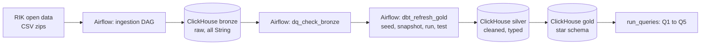
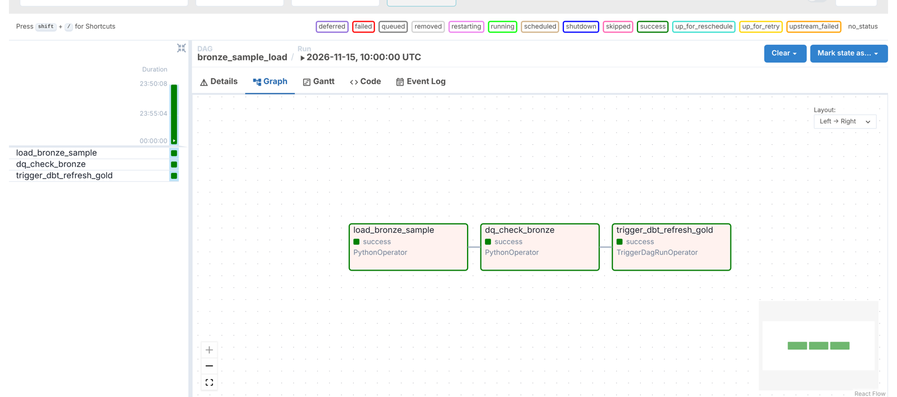
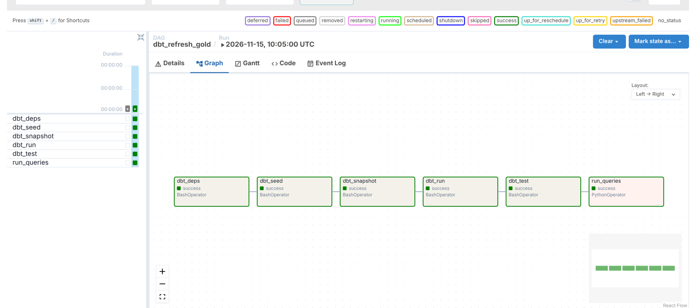

# Estonian Company Performance Observatory

Data Engineering (LTAT.02.007) project, Group 8: Olena Ushenko, Melih Arık, Kristjan Orrin,
Gabriel Alexandre Serens de Almeida, Ege Kutay Yürüsen.

How do growth, profitability and productivity of Estonian companies differ by industry and size?
The pipeline loads the annual-report open data of the Estonian e-Business Register (RIK) for the report
years 2022 to 2025 into ClickHouse, cleans it with dbt into a star schema and answers five questions (Q1 to Q5).

- [Architecture](#architecture)
- [Repository layout](#repository-layout)
- [Setup and run](#setup-and-run)
- [Environment variables](#environment-variables)
- [Data model](#data-model)
- [Data quality](#data-quality)
- [Analytical queries and results](#analytical-queries-and-results)
- [Screenshots](#screenshots)
- [Tests](#tests)
- [Extra credit](#extra-credit)

## Architecture

Docker Compose runs ClickHouse (storage and compute), Apache Airflow (orchestration, Postgres as its
metadata database) and dbt (transformations, run by Airflow).



| Layer | ClickHouse database | Built by | Contents |
|---|---|---|---|
| Bronze | `bronze` | Airflow (`scripts/load_bronze.py`) | one table per RIK file, every column as text, `ReplacingMergeTree` |
| Silver | `silver` | dbt (`dbt/models/silver/`) | typed values, one wide row per report, one report per company-year |
| Gold | `gold` | dbt (`dbt/models/gold/`, `dbt/snapshots/`, `dbt/seeds/`) | `fact_company_year` and four dimensions |

Run order: ingestion DAG loads bronze, `dq_check_bronze` checks it, the last task triggers
`dbt_refresh_gold` (`dbt deps >> seed >> snapshot >> run >> test >> run_queries`).
Details: `docs/pipeline_contracts.md`, why ClickHouse: `docs/report/architecture_and_clickhouse.md`.

## Repository layout

| Path | What |
|---|---|
| `docker-compose.yml`, `airflow/Dockerfile`, `.env.example` | the stack (ClickHouse 26.8, Airflow 2.10.5, dbt 1.11 in its own venv) |
| `airflow/dags/` | `bronze_sample_load` (sample), ingestion DAG(s), `dbt_refresh_gold` |
| `scripts/load_bronze.py`, `scripts/bronze_schema.py` | bronze loader and the file-to-table contract |
| `scripts/dq_bronze.py` | data-quality checks on bronze (Airflow task `dq_check_bronze`) |
| `scripts/run_queries.py` | runs Q1 to Q5 and writes the results as Markdown |
| `clickhouse/init/` | databases and bronze tables, created on first start |
| `dbt/` | dbt project `observatory`: sources, silver and gold models, snapshot, seeds, tests, key macros |
| `sql/queries/` | Q1 to Q5 in ClickHouse SQL |
| `sql/project1_postgres/` | Project 1 PostgreSQL DDL and queries, kept for comparison |
| `data/sample/rik_bronze_sample_bundle.txt` | small real RIK sample (587 companies, 1,959 reports) |
| `docs/` | contracts, bronze tables, surrogate keys, data quality, report sections, screenshots |
| `tests/` | unit tests (no services needed) and how the parts were tested |

## Setup and run

Requirements: Docker Desktop (or Docker Engine with Compose v2) and internet
access for the first build and for the RIK downloads.

1. Configure

   ```bash
   cp .env.example .env
   # set the passwords, then generate the two Airflow keys:
   python -c "from cryptography.fernet import Fernet; print(Fernet.generate_key().decode())"   # AIRFLOW_FERNET_KEY
   python -c "import secrets; print(secrets.token_hex(32))"                                    # AIRFLOW_SECRET_KEY
   ```
   On Linux also set `AIRFLOW_UID` to the output of `id -u`.

2. Start the stack

   ```bash
   docker compose up -d --build
   ```
   Airflow UI: http://localhost:8080 (user and password from `AIRFLOW_ADMIN_USER` / `AIRFLOW_ADMIN_PASSWORD`).
   ClickHouse HTTP: http://localhost:8123. ClickHouse creates the `bronze`, `silver` and `gold` databases and
   the bronze tables on its first start.

3. Quick run on the sample (a few seconds, no download)

   ```bash
   docker compose exec airflow-scheduler airflow dags trigger bronze_sample_load
   ```
   `load_bronze_sample >> dq_check_bronze >> trigger_dbt_refresh_gold`, then `dbt_refresh_gold` builds
   silver and gold, tests them and writes the query results to `data/query_results.md`.

4. Full run (real RIK files)

   Trigger the ingestion DAG in the UI or with `airflow dags trigger <ingestion DAG id>`
   [ingestion DAG id and its parameters: Olena]. It downloads the files of `RIK_FILE_VERSION` for the years in
   `RIK_YEARS` into `data/raw/`, loads them into bronze, runs `dq_check_bronze` and triggers `dbt_refresh_gold`.
   A rerun for the same year replaces that year's partition, so it does not create duplicates.

5. Rebuild gold from scratch (for example after a model change)

   ```bash
   docker compose exec airflow-scheduler airflow dags trigger dbt_refresh_gold --conf '{"full_refresh": true}'
   ```

Useful commands:

```bash
docker compose run --rm dbt build --select gold      # ad-hoc dbt (same image)
docker compose run --rm dbt test                     # all dbt tests
docker compose run --rm dbt docs generate            # docs and lineage graph (target/)
docker compose exec airflow-scheduler python /opt/airflow/scripts/dq_bronze.py --years 2022,2023,2024,2025
docker compose exec airflow-scheduler python /opt/airflow/scripts/run_queries.py   # Q1 to Q5 to stdout
docker compose down          # stop (data is kept in volumes)
docker compose down -v       # stop and delete all ClickHouse and Airflow data
```

After changing `dbt/packages.yml`, run `docker compose build`: dbt packages are baked into the image.

## Environment variables

Set in `.env` (template: `.env.example`), passed to the containers by `docker-compose.yml`.

| Variable | Used by | Default in `.env.example` |
|---|---|---|
| `CLICKHOUSE_USER`, `CLICKHOUSE_PASSWORD` | ClickHouse server, dbt profile, loader, checks | `observatory` / `change-me` |
| `CLICKHOUSE_HTTP_PORT_HOST`, `CLICKHOUSE_NATIVE_PORT_HOST` | host ports of ClickHouse | `8123`, `9000` |
| `CLICKHOUSE_HOST`, `CLICKHOUSE_PORT` | dbt profile, loader (set in compose) | `clickhouse`, `8123` |
| `RIK_FILE_VERSION` | loader, ingestion | `31102026` (date part of the RIK file names, changes monthly) |
| `RIK_YEARS` | ingestion, `dq_check_bronze`, dbt cross-layer test | `2022,2023,2024,2025` |
| `DBT_PROJECT_DIR`, `DBT_PROFILES_DIR`, `DBT_TARGET` | dbt DAG, dbt service | `/opt/airflow/dbt`, same, `dev` |
| `DATA_DIR`, `SCRIPTS_DIR`, `CLICKHOUSE_INIT_DIR` | DAGs, loader | `/opt/airflow/data`, `/opt/airflow/scripts`, `/opt/airflow/clickhouse/init` |
| `DBT_PACKAGES_INSTALL_PATH` | dbt | set in the image: `/opt/dbt/packages` |
| `DBT_SKIP_DEPS` | `dbt_deps` task | unset; `true` never runs `dbt deps` (offline) |
| `AIRFLOW_UID` | Airflow containers | `50000` (Linux: `id -u`) |
| `AIRFLOW_ADMIN_USER`, `AIRFLOW_ADMIN_PASSWORD`, `AIRFLOW_ADMIN_EMAIL` | Airflow UI login | `admin` / `change-me` |
| `AIRFLOW_FERNET_KEY`, `AIRFLOW_SECRET_KEY` | Airflow | generate (step 1) |
| `AIRFLOW_WEBSERVER_PORT_HOST` | host port of the UI | `8080` |
| `POSTGRES_USER`, `POSTGRES_PASSWORD`, `POSTGRES_DB` | Airflow metadata database | `airflow` / `change-me` / `airflow` |

## Data model

Star schema in `gold`. Grain of the fact: one row per company per calendar year, from the one selected
annual report of that company-year. Keys are md5 hashes of the natural keys (32-character `String`), made
by the macros in `dbt/macros/surrogate_keys.sql` (`docs/surrogate_keys.md`), so the fact and the dimensions
can be built independently. ClickHouse does not enforce foreign keys; dbt tests check them.

```dbml
Table dim_company {
  company_key varchar(32) [pk, note: 'md5(registry_code, dbt_valid_from): one SCD2 version']
  company_id varchar(32) [note: 'md5(registry_code): same for all versions']
  registry_code varchar
  company_name varchar
  legal_form varchar
  county varchar
  valid_from datetime
  valid_to datetime [null]
  is_current boolean
  Note: 'SCD Type 2 (dbt snapshot snap_company): name, legal form and county can change'
}

Table dim_year {
  year_key varchar(32) [pk]
  year int
  Note: 'Static'
}

Table dim_industry {
  industry_key varchar(32) [pk, note: 'md5(section_code, emtak_version)']
  section_code varchar
  section_name varchar
  emtak_version varchar
  Note: 'Static within an EMTAK version (2008 or 2025)'
}

Table dim_size_band {
  size_band_key varchar(32) [pk, note: 'md5(band_code)']
  band_code varchar [note: 'micro, small, medium, large, unknown']
  band_label varchar
  sort_order int
  Note: 'Type 1, seed file: micro < 10 FTE, small 10 to 49, medium 50 to 249, large 250+'
}

Table fact_company_year {
  company_year_key varchar(32) [pk, note: 'md5(registry_code, year)']
  company_id varchar(32)
  company_key varchar(32) [ref: > dim_company.company_key]
  year_key varchar(32) [ref: > dim_year.year_key]
  industry_key varchar(32) [ref: > dim_industry.industry_key]
  size_band_key varchar(32) [ref: > dim_size_band.size_band_key]
  report_id varchar
  revenue decimal
  operating_profit decimal
  assets decimal
  equity decimal
  cash decimal
  current_assets decimal
  current_liabilities decimal
  employee_expense decimal
  avg_fte decimal
  Note: 'Grain: one row per company per calendar year'
}
```

Every dimension has an `UNKNOWN` member, so fact rows with a missing natural key still join.
[Final column list: Kristjan (dimensions) and Gabriel (fact), see their YAML docs in `dbt/models/`.]

## Data quality

Full description: `docs/data_quality.md`.

- **Airflow, before dbt** (`scripts/dq_bronze.py`, task `dq_check_bronze`): fails the run if a bronze table
  is missing columns or empty, a configured year is missing, `report_id` or the registry code is empty, or
  `report_id` is duplicated in the source file. Warnings for orphan rows, non-numeric values and companies
  with several reports in one year. The result table is printed in the task log.
- **dbt** (run by the `dbt_test` task; a failed test fails `dbt_refresh_gold`): format checks on the bronze
  sources with `dbt_expectations`, and singular tests on gold for the grain (one row per company-year),
  fact keys that match a dimension, SCD2 validity, unknown members, value ranges (no negative FTE; negative
  revenue, assets or cash as a warning) and a reconciliation of bronze against gold.

## Analytical queries and results

The Project 1 queries (`sql/project1_postgres/queries/`) rewritten for ClickHouse (`sql/queries/`):

| | Question | Main ClickHouse change |
|---|---|---|
| Q1 | Industries with the highest median revenue growth 2024 to 2025 | `anyIf` per year in one `GROUP BY company_id` instead of a `LAG` window |
| Q2 | Industries with the highest median operating margin 2025 | `quantileExactInclusive(0.5)` instead of `PERCENTILE_CONT(0.5)` |
| Q3 | Revenue per employee by employee size band 2025 | same |
| Q4 | Median operating margin by company size 2025 | same |
| Q5 | Companies that grew revenue while their operating margin fell | as Q1, plus `count() OVER ()` for the total number of matches |

Rules from Project 1 kept in every query: a ratio needs a positive denominator, sector comparisons use
medians, every result shows its sample size, groups with fewer than 30 companies are left out.
`quantileExactInclusive` gives exactly the same median as PostgreSQL's `PERCENTILE_CONT`; `median()` would
be approximate.

Results are written by the `run_queries` task to `data/query_results.md` after every `dbt_refresh_gold`
run. To refresh the section below: `python scripts/run_queries.py --readme README.md --label "full data"`
(from the host with `CLICKHOUSE_*` exported and `pip install clickhouse-connect`).

<!-- QUERY_RESULTS_START -->
Results of the last run (2026-11-15, ClickHouse 26.9.2.1, 1,959 rows in gold.fact_company_year, PLACEHOLDER: sample data (587 companies) and test versions of the silver and gold models, only to show the format. Replace with a full-data run).

### Q1. Which industries have the highest median revenue growth (2024 -> 2025)?

`sql/queries/q1_median_revenue_growth_by_industry.sql`, 2 rows, 17 ms

| section_code | section_name | n_companies | median_revenue_growth_pct |
|---|---|---|---|
| M | Professional, scientific and technical | 35 | 12.2 |
| G | Wholesale and retail trade | 36 | -4.5 |

### Q2. Which industries have the highest median operating margin (2025)?

`sql/queries/q2_median_operating_margin_by_industry.sql`, 3 rows, 9 ms

| section_code | section_name | n_companies | median_operating_margin_pct |
|---|---|---|---|
| M | Professional, scientific and technical | 43 | 21.4 |
| F | Construction | 32 | 8.9 |
| G | Wholesale and retail trade | 40 | 0.1 |

### Q3. How does revenue per employee differ by employee size band (2025)?

`sql/queries/q3_revenue_per_employee_by_size_band.sql`, 1 rows, 8 ms

| band_label | n_companies | median_revenue_per_employee_eur |
|---|---|---|
| Micro (<10 FTE) | 118 | 48,278.0 |

### Q4. How does the median operating margin vary by company size (2025)?

`sql/queries/q4_median_operating_margin_by_size_band.sql`, 1 rows, 36 ms

| band_label | n_companies | median_operating_margin_pct |
|---|---|---|
| Micro (<10 FTE) | 289 | 7.1 |

### Q5. Which companies grew revenue from 2024 to 2025 while their operating margin declined?

`sql/queries/q5_revenue_up_margin_down.sql`, 50 rows, 16 ms

| registry_code | company_name | revenue_growth_pct | operating_margin_2024_pct | operating_margin_2025_pct | n_matching |
|---|---|---|---|---|---|
| 17024507 | PiirdeHunt OÜ | 10,345.7 | 41.6 | 19.6 | 51 |
| 16107007 | MEFS OÜ | 2,711.1 | 96.9 | 23.6 | 51 |
| 16983507 | O'Rourke Studios OÜ | 867.5 | 42.0 | 40.3 | 51 |
| 12790007 | Naviworks OÜ | 660.0 | 65.4 | 41.2 | 51 |
| 10842007 | Acorn Blu OÜ | 526.7 | 100.0 | 55.9 | 51 |
| 17070007 | NWEST OÜ | 352.1 | 6.5 | -1.4 | 51 |
| 10734507 | Lavet Consult OÜ | 315.3 | 13.4 | 5.2 | 51 |
| 12516507 | Kivilend OÜ | 179.5 | 29.4 | 25.5 | 51 |
| 16976507 | Innoscience OÜ | 140.5 | 31.9 | 28.1 | 51 |
| 10727507 | osaühing UNIGRAM | 114.1 | 7.2 | -4.7 | 51 |

_40 more rows not shown._

<!-- QUERY_RESULTS_END -->

## Screenshots

`bronze_sample_load` (sample run: load, data-quality check, trigger):



`dbt_refresh_gold` (triggered by the ingestion DAGs; `run_queries` runs Q1 to Q5 at the end):



[Ingestion DAG screenshot: Olena, `docs/screenshots/airflow_ingestion.png`]

[dbt lineage graph (`dbt docs generate`, then the lineage view): `docs/screenshots/dbt_lineage.png`]

## Tests

```bash
python -m unittest discover -s tests -v     # unit tests, no services needed
docker compose run --rm dbt test            # dbt tests against ClickHouse
```

How each part was tested: `tests/README.md` (bronze, Docker stack) and `docs/data_quality.md` (checks and
queries).

## Extra credit

**A. ClickHouse instead of PostgreSQL**, tied to our query patterns (column storage, MergeTree partitions
and pruning, sparse primary index, exact quantile functions, trade-offs):
`docs/report/extra_credit_clickhouse_vs_postgres.md`, measurements reproducible with
`docs/report/extra_credit_benchmark.sql`.
