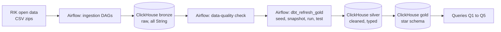

# Architecture and why ClickHouse (draft, Ege)

## Updated architecture

The pipeline runs as a Docker Compose stack with three main components: Apache Airflow for orchestration, ClickHouse for storage and computation, and dbt for transformations. Airflow ingestion DAGs download the annual-report files and the company basic-data file from the Estonian e-Business Register (RIK) open-data portal and load them unchanged into the bronze layer. A data-quality task then checks the loaded tables, and the last ingestion task triggers a separate DAG that runs `dbt seed`, `dbt snapshot`, `dbt run` and `dbt test`. dbt builds a cleaned and typed silver layer and the gold star schema (`fact_company_year` with company, industry, year and size-band dimensions), on which the analytical queries Q1 to Q5 run.

The three medallion layers are separate ClickHouse databases (`bronze`, `silver`, `gold`). Surrogate keys are md5 hashes of the natural keys, generated by shared dbt macros, so the fact table and the dimensions can be built independently and still join.

## Changes since Project 1

Project 1 proposed Apache Iceberg for the raw and staging data and Apache Superset and OpenMetadata for presentation and metadata. In the implemented pipeline all three layers live in ClickHouse, and Superset and OpenMetadata are not part of the current stack. [To confirm with the team: the reasons for dropping Iceberg, Superset and OpenMetadata.] The star schema from Project 1 is kept, but its integer keys are replaced by hash keys and its foreign-key constraints by dbt relationship tests, because ClickHouse has neither sequences nor enforced foreign keys.

## Why ClickHouse

The choice follows from the shape of our data and questions. The source files are large and narrow: the report metadata file has about 1.6 million reports, and each yearly financial-elements file is in long format with roughly 3.6 to 3.9 million rows, one row per report, statement table and element. Silver has to pivot these rows into columns, and gold queries scan many companies at once. All five questions are aggregations over the whole population, mostly medians of growth and margin ratios per industry or size band. ClickHouse is a column store, so a query reads only the columns it uses, and it provides `median`, `quantile` and `quantileExact` aggregate functions, so medians per group are computed directly in a `GROUP BY`.

Physical design can follow the queries. MergeTree tables are sorted by their `ORDER BY` key and can be partitioned, for example the elements table by report year, so one year can be reloaded or pruned on its own. Columnar compression suits the fact table, which has many numeric columns with repeated values. For bronze we use `ReplacingMergeTree`, and the loader replaces whole partitions, so rerunning an ingestion does not create duplicate rows.

## Trade-offs and how we handle them

ClickHouse does not enforce primary or foreign keys, and `ReplacingMergeTree` removes duplicate keys only eventually, during background merges, so queries on bronze must use `FINAL`. It also removes duplicates already at insert time, which would hide duplicate records in a source file; our loader therefore counts them before the insert. Updates, deletes and complex joins are weaker than in PostgreSQL, which matters for the SCD Type 2 company dimension; we keep history with dbt snapshots and look up the valid company version with an `ASOF` join. These gaps are covered by tests rather than constraints: dbt `unique`, `not_null` and `relationships` tests on keys, a singular test for the key macros, and Airflow data-quality checks on bronze. If a test fails, the dbt DAG run fails.
